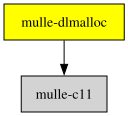

# mulle-dlmalloc

#### A relocatable allocator for one shared-memory arena.


# mulle-dlmalloc

A relocatable allocator for one shared-memory arena.

**mulle-dlmalloc** keeps all of its metadata in shared memory as arena-relative
offsets instead of process-local pointers, so the same arena can be mapped at a
different virtual address in every process that attaches it. There is no
trimming and no allocations outside the arena.

An arena starts as one fixed segment. It can grow by adding segments through the
embedder's callbacks: `dlmalloc_offset_arena_grow` adds a segment (each twice the
previous size) and every attached process notices the new space from an epoch
counter on its next call. The backing store and the actual mappings are the
embedder's job — dlmalloc only stores offsets and the segment directory, and
never opens files or calls mmap itself. Without callbacks the arena stays fixed.

mulle-dlmalloc is used by the [mulle-mmapallocator](//github.com/mulle-core/mulle-mmapallocator) to manage shared memory and separate memory arenas.

The API is offset based: `dlmalloc_offset_arena_init` / `dlmalloc_offset_arena_attach`,
`dlmalloc_offset_malloc` and friends return and accept `dlmalloc_offset_t` values.
A pointer returned by `dlmalloc_offset_resolve` is valid only in the calling
process while the object is live; persistent references stored in the arena must
be offsets. The implementation is self-contained in `src/dlmalloc.c` and needs no
compile-time flags. See `GROWTH-SCHEME.md` for the growth design.


| Release Version                                       | Release Notes  | AI Documentation
|-------------------------------------------------------|----------------|---------------
|    [](//github.com/mulle-core/mulle-dlmalloc/actions) | [RELEASENOTES](RELEASENOTES.md) | [DeepWiki for mulle-dlmalloc](https://deepwiki.com/mulle-core/mulle-dlmalloc)


## Documentation & Guides

* [API Summary](asset/dox/api/toc)


### You are here




## Add

mulle-dlmalloc is a component of the [mulle-core](//github.com/mulle-core/mulle-core) library. So in your code include the mulle-core umbrella header:

``` c
#include <mulle-core/mulle-core.h>
```

### Add mulle-core to a cmake project

Add mulle-core to your `CMakeLists.txt` with
[FetchContent](https://cmake.org/cmake/help/latest/module/FetchContent.html):

``` cmake
include( FetchContent)

set( MULLE__CORE_TAG "master" CACHE STRING "branch or tag to fetch mulle-core from")

FetchContent_Declare( MULLE__CORE
   GIT_REPOSITORY https://github.com/mulle-core/mulle-core.git
   GIT_TAG        "${MULLE__CORE_TAG}")
FetchContent_MakeAvailable( MULLE__CORE)

target_link_libraries( ${PROJECT_NAME} PRIVATE mulle-core)
```


### Add mulle-core to a mulle-sde project

``` sh
mulle-sde add github:mulle-core/mulle-core
```

### Embed mulle-dlmalloc with clib

``` sh
clib install --out src mulle-core/mulle-dlmalloc
```

Append `src` to your include path (e.g. add `-isystem src`  to your `CFLAGS`)
and compile all the sources that were downloaded.

## Install

Use [mulle-sde](//github.com/mulle-sde) to build and install mulle-dlmalloc and all dependencies:

``` sh
mulle-sde install --prefix /usr/local \
   https://github.com/mulle-core/mulle-dlmalloc/archive/latest.tar.gz
```

### Manual Installation

Install the requirements:

| Requirements                                 | Description
|----------------------------------------------|-----------------------
| [mulle-c11](https://github.com/mulle-c/mulle-c11)             | 🔀 Cross-platform C compiler glue (and some cpp conveniences)

Download the latest [tar](https://github.com/mulle-core/mulle-dlmalloc/archive/refs/tags/latest.tar.gz) or [zip](https://github.com/mulle-core/mulle-dlmalloc/archive/refs/tags/latest.zip) archive and unpack it.

Install **mulle-dlmalloc** into `/usr/local` with [cmake](https://cmake.org):

``` sh
PREFIX_DIR="/usr/local"
cmake -B build                               \
      -DMULLE_SDK_PATH="${PREFIX_DIR}"       \
      -DCMAKE_INSTALL_PREFIX="${PREFIX_DIR}" \
      -DCMAKE_PREFIX_PATH="${PREFIX_DIR}"    \
      -DCMAKE_BUILD_TYPE=Release &&
cmake --build build --config Release &&
cmake --install build --config Release
```


## Author

[Nat!](https://mulle-kybernetik.com/weblog) for Mulle kybernetiK  


